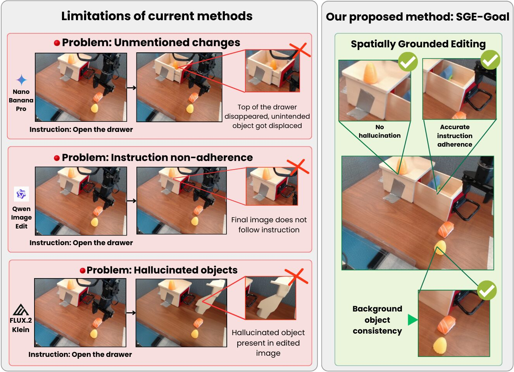
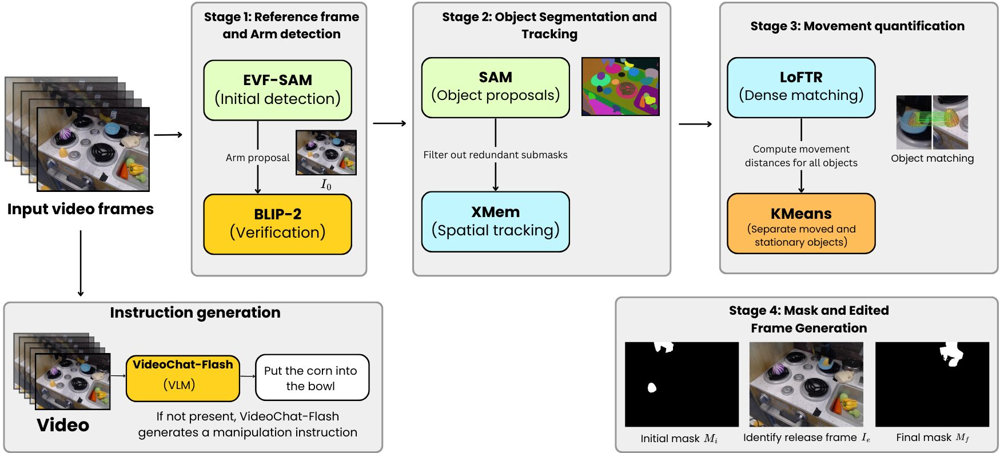
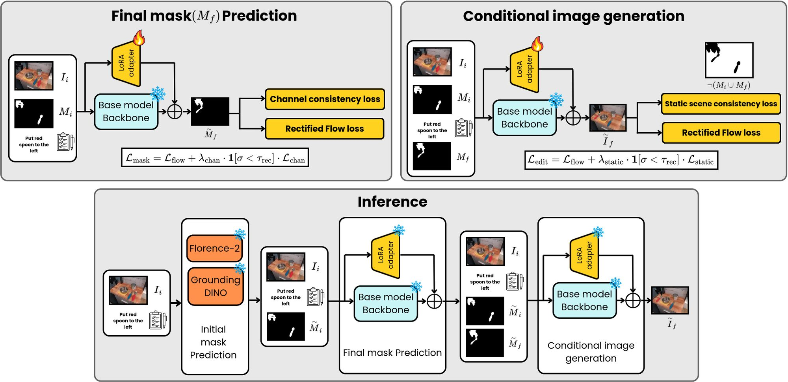

<div align="center">

# Goal Images Are Control Targets

### Spatially-Grounded Goal-Image Synthesis for Robotic Manipulation

**WACV 2027** &nbsp;·&nbsp; Accepted in Round 1

**Riddhi Chatterjee · Ritish Shrirao · Kushagra Mehrotra · Viswanath Gopalakrishnan**

International Institute of Information Technology Bangalore (IIIT-B)

[](#)
[](#)
[](#)
[](https://riddhi-chatterjee.github.io/SGE-Goal/)
[](https://huggingface.co/RiddhiCh/SGE-Goal)
[](#processed-datasets)

**[Overview](#overview)** &nbsp;·&nbsp;
**[Key Findings](#key-findings)** &nbsp;·&nbsp;
**[Results](#results)** &nbsp;·&nbsp;
**[Method](#method)** &nbsp;·&nbsp;
**[Release Checklist](#release-checklist)** &nbsp;·&nbsp;
**[Citation](#citation)**

</div>

---

> [!NOTE]
> **This repository is being populated.** The paper was accepted at WACV 2027 in the first
> round, and we are now working through the public release of everything we promised: the
> full SGE-Goal codebase, model checkpoints, the automated data-generation pipeline, the
> processed datasets, and our 15-dimension human-aligned diagnostic evaluator. The
> [Release Checklist](#release-checklist) below is the live, authoritative status of that
> effort. Links marked *coming soon* will be filled in as each artifact lands.

<div align="center">
  
  <p><em>Goal images are control targets, not artworks. A goal image must move the
  <b>correct</b> object to the <b>correct</b> final state and avoid spurious changes that
  mislead the policy. SGE-Goal achieves this through explicit spatial grounding, while
  strong general-purpose editors introduce unmentioned changes, miss the instruction,
  or hallucinate objects.</em></p>
</div>

## Overview

Goal-conditioned manipulation policies are steered by a **goal image**: a picture of the
desired post-manipulation scene, synthesized from the current observation and a language
instruction. Because the robot cannot observe the future, this image must be *generated* —
which turns goal-image synthesis into an image-editing problem.

The field's prevailing assumption follows naturally: *a better edit is a better goal.* Goal
generators are therefore built and compared using general image-editing metrics and
leaderboards, on which large proprietary editors dominate.

**We show this assumption is false.** Across two independent, frozen goal-conditioned
policies on CALVIN, the editors that top aggregate editing-quality leaderboards
(Gemini 3 Pro Image and GPT Image 1.5) produce **worse** control targets than far smaller
fine-tuned open models — and the gap widens sharply on the multi-step tasks robots actually
face. The reason is a clean **dissociation**: downstream policy success is governed almost
entirely by manipulation *adherence* (selecting the right object and the right final state,
Spearman ρ ≈ 0.9), while *photorealism* and aesthetic fidelity — precisely where proprietary
editors win — are uncorrelated with success (ρ ≈ 0).

Guided by this finding, we present **SGE-Goal**, a spatially-grounded decomposed editing
framework that predicts *initial* and *final* 2D edit-region masks before synthesizing the
goal image. SGE-Goal turns ordinary open base models (FLUX.1 Kontext, FLUX.2 klein) into the
strongest goal generators we evaluate on CALVIN, and second only to Gemini 3 Pro Image on the
real-world-aligned SIMPLER-Bridge benchmark — while running entirely on-premise at ~10.6 s
per goal image on a single A10G.

## Key Findings

<table>
<tr><td width="34%"><b>Editing quality is a misaligned proxy</b></td>
<td>The editing-quality ranking of goal generators does not match their downstream
success-rate ranking. This inversion appears on <b>all three</b> datasets
(BridgeDataV2, CALVIN, LIBERO) and under <b>both</b> editing evaluators. Aggregate
editing score correlates only weakly with policy success (ρ ≈ 0.67) and mis-orders the
top methods.</td></tr>

<tr><td><b>Adherence predicts success; photorealism does not</b></td>
<td>A 15-dimension decomposition of every goal image isolates the mechanism. Source and
destination adherence correlate with policy success at |ρ| = 0.88–0.95 on CALVIN and
0.85 / 0.66 on SIMPLER-Bridge. Photorealism sits at |ρ| ≲ 0.25 on CALVIN and 0.02 on
Bridge. An exact permutation test on CALVIN gives ρ = 0.98 (<i>p</i> &lt; 10⁻³) for source
adherence versus ρ = 0.03 (<i>p</i> = 0.95) for photorealism.</td></tr>

<tr><td><b>Spatial grounding wins where it matters — long horizons</b></td>
<td>From chain length 1 → 5 under GR-MG, SGE-Goal (FLUX.1 Kontext) degrades 73.1% → 30.9%,
while Gemini 3 Pro Image collapses 63.3% → 4.4% and SuSIE 55.8% → 1.0%. At five chained
steps SGE-Goal sustains roughly <b>7×</b> the success rate of the best proprietary
editor.</td></tr>

<tr><td><b>The result is a property of the goal images, not of one policy</b></td>
<td>Two independent pre-trained policies (GR-MG and GHIL-Glue) rank the nine generators
near-identically (ρ = 0.98), and the dissociation reproduces on the real-world-aligned
SIMPLER-Bridge benchmark.</td></tr>

<tr><td><b>Visual goals beat text goals at every horizon</b></td>
<td>Image + text conditioning dominates text-only conditioning at every chain length
(73.1% vs 59.0% at CL 1, widening to 30.9% vs 0.2% at CL 5), extending the single-step
finding of MUTEX into the long-horizon regime.</td></tr>

<tr><td><b>Open, on-premise, and reproducible</b></td>
<td>The full pipeline — data generation, both fine-tuned stages, and the diagnostic
evaluator — runs on open models only. No proprietary API is required to reproduce any
part of this work.</td></tr>
</table>

## Results

### Downstream policy success on CALVIN

Success rate (%, ↑) with **only the goal generator varied**, across chain lengths 1–5, for
two pre-trained and frozen goal-conditioned policies. SGE-Goal yields the best policy at
*every* chain length under *both* policies, matches the GR-MG oracle at CL 1, and degrades
most gracefully. FK = FLUX.1 Kontext [Dev], F2K = FLUX.2 [klein], base = untuned editor.

| Method | GR-MG · 1 | 2 | 3 | 4 | 5 | GHIL-Glue · 1 | 2 | 3 | 4 | 5 |
|---|---|---|---|---|---|---|---|---|---|---|
| *GT goal (oracle)* | *73.6* | – | – | – | – | *39.0* | – | – | – | – |
| **SGE-Goal (FK)** | **73.1** | **59.7** | **47.3** | **36.8** | **30.9** | **29.2** | **12.0** | **3.7** | **0.8** | 0.0 |
| **SGE-Goal (F2K)** | 71.8 | 53.8 | 34.8 | 21.4 | 17.3 | 22.8 | 8.1 | 1.5 | 0.1 | 0.0 |
| Gemini 3 Pro Image | 63.3 | 36.9 | 18.1 | 8.1 | 4.4 | 13.2 | 2.4 | 0.0 | 0.0 | 0.0 |
| Clover | 63.2 | 34.2 | 12.8 | 3.6 | 1.9 | 17.3 | 3.2 | 0.2 | 0.0 | 0.0 |
| GPT Image 1.5 | 60.2 | 36.7 | 17.1 | 6.2 | 3.4 | 8.0 | 0.7 | 0.0 | 0.0 | 0.0 |
| Qwen Image Edit | 59.4 | 33.7 | 13.4 | 4.6 | 2.2 | 7.2 | 1.1 | 0.0 | 0.0 | 0.0 |
| SuSIE | 55.8 | 28.4 | 9.9 | 2.6 | 1.0 | 6.1 | 0.1 | 0.0 | 0.0 | 0.0 |
| FLUX.2 klein (base) | 52.0 | 29.6 | 13.4 | 5.2 | 2.9 | 2.9 | 0.0 | 0.0 | 0.0 | 0.0 |
| FLUX.1 Kontext (base) | 50.3 | 28.6 | 12.8 | 4.8 | 2.6 | 2.6 | 0.0 | 0.0 | 0.0 | 0.0 |

### Downstream policy success on SIMPLER-Bridge

Success rate (%, ↑) on the real-world-aligned WidowX / BridgeData-V2 simulator under the
frozen GHIL-Glue policy, across four atomic tasks (24 episodes each). SGE-Goal is the
strongest open generator and second overall. Both variants surpass SuSIE despite SuSIE's
home-field advantage — GHIL-Glue is the SuSIE system's low-level policy, trained to reach
SuSIE-style goals.

| Method | Spoon | Carrot | Stack | Eggplant | Mean |
|---|---|---|---|---|---|
| Gemini 3 Pro Image | **16.7** | **29.2** | 0.0 | 4.2 | **12.5** |
| **SGE-Goal (F2K)** | 16.7 | 16.7 | 0.0 | **8.3** | 10.4 |
| **SGE-Goal (FK)** | 8.3 | 20.8 | 0.0 | 4.2 | 8.3 |
| SuSIE | 16.7 | 8.3 | **4.2** | 0.0 | 7.3 |
| Qwen Image Edit | 8.3 | 4.2 | 0.0 | 0.0 | 3.1 |
| GPT Image 1.5 | 4.2 | 0.0 | 0.0 | 4.2 | 2.1 |
| FLUX.2 klein (base) | 4.2 | 4.2 | 0.0 | 0.0 | 2.1 |
| FLUX.1 Kontext (base) | 4.2 | 4.2 | 0.0 | 0.0 | 2.1 |
| Clover | 4.2 | 0.0 | 0.0 | 0.0 | 1.0 |

### The inversion: editing quality vs. control utility

Rank generators by editing quality and the field's usual ordering returns — and it is *wrong*
for manipulation. Gemini tops our human-aligned evaluator, GPT tops I2I-Bench, yet both are
only mid-pack downstream. Br = BridgeDataV2, Ca = CALVIN, Li = LIBERO.

| Method | Our eval, rank ↓ · Br | Ca | Li | I2I-Bench, score ↑ · Br | Ca | Li |
|---|---|---|---|---|---|---|
| Gemini 3 Pro Image | **2.07** | **2.65** | **1.81** | 0.785 | 0.707 | 0.675 |
| GPT Image 1.5 | 5.15 | 5.09 | 3.04 | **0.801** | **0.716** | **0.774** |
| Qwen Image Edit | 4.14 | 4.17 | 2.06 | 0.646 | 0.642 | 0.680 |
| **SGE-Goal (FLUX.2 klein)** | 2.99 | 3.41 | 4.98 | 0.655 | 0.626 | 0.484 |
| **SGE-Goal (FLUX.1 Kontext)** | 3.81 | 3.18 | 5.54 | 0.649 | 0.616 | 0.479 |
| Clover | – | 5.48 | – | – | 0.606 | – |
| SuSIE | 6.16 | 7.86 | 5.39 | 0.486 | 0.407 | 0.377 |
| FLUX.1 Kontext (base) | 5.48 | 7.33 | 6.51 | 0.533 | 0.449 | 0.378 |
| FLUX.2 klein (base) | 6.20 | 5.83 | 6.66 | 0.568 | 0.470 | 0.324 |

### Diagnostic evaluator: agreement with human judgment

Measured on 278 human-annotated triplets (%, ↑). This is what makes the evaluator
trustworthy as a *diagnostic* — downstream policy success remains the ground truth for
utility.

| | Adherence (R14–15) | Object pres. (R1–4) | Scene artifacts (R5–12) | Realism (R13) | **Average** | I2I-Bench |
|---|---|---|---|---|---|---|
| Agreement (%) | 85.5 | 90.3 | 92.8 | 100.0 | **91.7** | 71.2 |

### Runtime

End-to-end goal-image inference on a single A10G, entirely on open models, with no
proprietary API. Data generation is a one-time offline cost (A6000) and parallelizes freely.

| Inference stage | Time (s) | | Data-generation stage | Time (s) |
|---|---|---|---|---|
| Initial mask (Mᵢ) | 2.47 | | EVF-SAM + BLIP-2 | 4.46 |
| Final mask (M_f) | 5.16 | | SAM (first frame) | 1.07 |
| Goal image (Îₑ) | 2.92 | | XMem tracking | 7.76 |
| **Total** | **10.55** | | LoFTR + KMeans | 8.74 |

## Method

SGE-Goal has three released components: an automated data-extraction pipeline, the
three-step spatially-grounded editing framework, and a 15-dimension diagnostic evaluator.

<div align="center">
  
  
</div>

### 1 · Automated data extraction — no manual annotation

Each training sample is a tuple `(I_o, I_e, M_i, M_f, T)`: the original image, the edited
(post-manipulation) image, the initial edit-region mask localizing the dynamic objects, the
final edit-region mask marking their post-manipulation locations, and the instruction. We
extract these from raw robot videos by chaining six vision foundation models:

| Stage | What it does | Models |
|---|---|---|
| 1 | Robotic-arm masking and first-frame selection | EVF-SAM, BLIP-2 (VQA verification) |
| 2a | Class-agnostic object proposals, filtered and merged | SAM |
| 2b | Temporal object tracking through the video | XMem |
| 3 | Dynamic vs. stationary separation by per-object motion | LoFTR, 2-means clustering |
| 4 | Edit-mask generation and edited-frame detection (release event) | — |
| 5 | Instruction generation for unlabelled datasets | VideoChat-Flash |

SGE-Goal operates at the **atomic** level: composite instructions ("open the drawer and put
the apple in it") are decomposed into their necessary-and-sufficient atomic constituents,
each processed in sequence with the generated goal becoming the next step's input.

### 2 · Decomposed goal-image synthesis

Given `(I_o, T)`, the pipeline predicts `M_i`, then `M_f`, then the goal image `Î_e`.
Grounding here is **2D localization of the edit** — binary edit-region masks in the image
plane — not metric 3D reasoning.

- **Step 1 — Initial mask `M_i` (training-free).** The instruction is parsed for target-object
  names; candidate boxes come from Florence-2 and Grounding DINO with progressively relaxed
  thresholds and per-object NMS; each candidate is verified by BLIP-2 VQA; survivors prompt
  SAM for a pixel-level mask. No fine-tuning.
- **Step 2 — Final mask `M_f`.** A LoRA fine-tune of the base editor predicts where dynamic
  objects reside *after* manipulation, from `(I_o, T, M_i)`, under the rectified-flow
  objective. An auxiliary **channel-consistency** loss (λ = 25, gated to σ < 0.35) enforces
  the binary mask's identical RGB channels.
- **Step 3 — Goal image `Î_e`.** A second LoRA fine-tune synthesizes the goal from
  `(I_o, T, M_i, M_f)`. An auxiliary **static-scene-consistency** loss (λ = 7, same gate)
  penalizes pixel-space deviation outside the union mask, preserving everything the
  instruction did not mention.

Decomposition turns one entangled task into three disentangled ones — foundation-model
grounding, pure spatial reasoning, and appearance synthesis under explicit spatial guidance —
which is what removes the shortcuts (editing in place, background drift, hallucination) that
end-to-end editors take.

### 3 · A 15-dimension diagnostic evaluator

A fully automated evaluator scores each `(I_o, I_e, T)` triplet along 15 manipulation-specific
dimensions, grouped into **adherence** (R14 source, R15 destination), **object preservation**
(R1–R4), **photorealism** (R13), and **scene artifacts** (R5–R12), using only open models
(VideoChat-Flash, SAM, XMem, BLIP-2, LoFTR, Grounding DINO, Qwen2.5). Aggregation is a
relevance-tiered weighted average of per-method ranks: adherence 60% (30% each), object
preservation 24%, photorealism 8%, scene artifacts 8%.

> We do **not** propose this — or any — image-editing metric as a substitute for downstream
> evaluation. It is a diagnostic that explains downstream behaviour.

### Training configuration

The recipe is shared across all fine-tuning runs; only the per-stage and per-dataset settings
below differ.

| | |
|---|---|
| Base editors | FLUX.1 Kontext [Dev], FLUX.2 klein |
| LoRA rank / α / dropout | 16 / 16 / 0 |
| Optimizer | 8-bit AdamW |
| Learning rate | 1 × 10⁻⁴, constant (200 warmup) |
| Batch size / grad. accumulation | 160 / 1 |
| Epochs | up to 75, one checkpoint per epoch; released checkpoint epochs below |
| Precision | bf16 (TF32) |
| Max. text tokens | 512 |
| Resolution | 256 (Bridge, CALVIN) / 128 (LIBERO) |
| Seed | 0 |
| Gate τ_rec / fraction | 0.35 / 1.0 |
| Guidance scale, Step 2 | 4.0 (FLUX.2 klein) / 1.0 (FLUX.1 Kontext) |
| Guidance scale, Step 3 | 1.0 |
| Inference denoising steps / guidance | 20 / 1.0 |

Selected checkpoint epoch per stage, base editor and dataset:

| Stage | Base editor | BridgeDataV2 | CALVIN-ABCD | LIBERO-10/90 |
|---|---|---|---|---|
| Step 2 · final mask | FLUX.1 Kontext [Dev] | 38 | 22 | 56 |
| Step 2 · final mask | FLUX.2 klein | 17 | 22 | 59 |
| Step 3 · goal image | FLUX.1 Kontext [Dev] | 18 | 18 | 64 |
| Step 3 · goal image | FLUX.2 klein | 9 | 15 | 71 |

### Processed datasets

Splits are assigned by MD5 hashing (seed 42) for reproducibility. All three datasets are on the
Hugging Face Hub.

| Dataset | Hugging Face | Train | Val | Test / inference |
|---|---|---|---|---|
| BridgeDataV2 (teleoperated) | [`RiddhiCh/LGRM_BridgeDataV2_Teleoperated`](https://huggingface.co/datasets/RiddhiCh/LGRM_BridgeDataV2_Teleoperated) | 40,851 | 1,000 | 2,000 |
| CALVIN-ABCD | [`RiddhiCh/Calvin-Dataset-Final`](https://huggingface.co/datasets/RiddhiCh/Calvin-Dataset-Final) | 22,000 | 966 | 1,087 |
| LIBERO-10/90 (combined) | [`RiddhiCh/LGRM_Libero_10_90_Combined`](https://huggingface.co/datasets/RiddhiCh/LGRM_Libero_10_90_Combined) | 6,464 | 358 | 376 |

Every row is one `(I_o, I_e, M_i, M_f, T)` tuple with the fields `id`, `original_image`,
`edited_image`, `initial_edit_region_mask`, `final_edit_region_mask` and `edit_instruction`. Each
dataset keeps its source's licence: CC BY 4.0 for BridgeDataV2, MIT for CALVIN and LIBERO (see the
dataset cards).

```python
from datasets import load_dataset

ds = load_dataset("RiddhiCh/Calvin-Dataset-Final")   # splits: train / validation / test
```

Extraction quality was verified independently: 50 annotators rated 500 tuples per dataset on
each of the four extracted components (1–5 scale). The **lowest** per-component mean across
all three datasets was 4.44 / 5.

## Repository Structure

Directories appear as they are released — see the [Release Checklist](#release-checklist) for
live status. Each top-level directory has its own `README.md`.

```
SGE-Goal/
├── sge_goal/                 # Core framework
│   ├── grounding/            # Step 1 — training-free initial-mask prediction
│   ├── mask_predictor/       # Step 2 — final edit-region mask (LoRA + channel-consistency)
│   │   ├── train/            #   per base editor × dataset
│   │   └── inference/
│   ├── synthesis/            # Step 3 — goal-image synthesis (LoRA + static-scene-consistency)
│   │   ├── train/            #   per base editor × dataset
│   │   └── inference/
│   └── pipelines/            # End-to-end inference drivers (Step 1 → 2 → 3)
├── data_pipeline/            # Automated extraction from raw robot video
├── evaluator/                # 15-dimension diagnostic evaluator (R1–R15 scripts, prompts inline)
│   ├── i2i_bench/            # I2I-Bench comparison harness
│   └── results/              # Aggregated per-method scores
├── downstream/               # Closed-loop policy evaluation
│   ├── calvin/               # GR-MG, GHIL-Glue and Octo-ft (fine-tuned by us), chain lengths 1–5
│   └── simpler_bridge/       # SIMPLER WidowX / BridgeData-V2 rollouts
├── baselines/                # Goal generators compared in the paper, and mask ablations
├── scripts/                  # Runtime benchmark results
├── third_party/              # Pinned upstream dependencies, patches and fetch script
├── docs/                     # Project page (GitHub Pages) and guides (docs/guides/)
├── LICENSE                   # Apache-2.0
├── CITATION.cff
├── CONTRIBUTING.md
└── CODE_OF_CONDUCT.md
```

## Release Checklist

Everything promised in the paper, tracked here. This section is the single source of truth
for what has shipped and what is still in flight.

### Phase 0 · Repository foundation

- [x] Create the official repository
- [x] README: overview, results, method, and this checklist
- [x] `LICENSE` — choose and add (code and checkpoints may need separate terms)
- [x] `CITATION.cff` for GitHub's "Cite this repository"
- [x] `.gitignore`, `CONTRIBUTING.md`, `CODE_OF_CONDUCT.md`
- [x] Author list, affiliations and contact details
- [ ] Repository description, topics and social preview image
- [ ] Make the repository public

### Phase 1 · Paper, links and assets

- [ ] Replace the arXiv placeholder with the live link
- [ ] Replace the OpenReview placeholder with the live link
- [ ] Add the official WACV 2027 proceedings link (once available)
- [x] Project page and replace the placeholder badge
- [ ] Verify the camera-ready `main.pdf` and `supplementary.pdf` against OpenReview, then commit
- [ ] Paper assets: teaser, data-generation pipeline, training/inference diagram, chaining-robustness plot, chained-prediction visualization, data-quality plot, qualitative comparison, training curves
- [x] Uncomment the teaser and method figures in this README
- [ ] Final BibTeX entry (replace the placeholder in [Citation](#citation))

### Phase 2 · Core SGE-Goal framework

- [x] Step 1 — training-free initial-mask grounding (Florence-2 + Grounding DINO + BLIP-2 + SAM)
- [x] Step 2 — final-mask predictor: LoRA fine-tuning under rectified flow + channel-consistency loss
- [x] Step 3 — goal-image synthesizer: LoRA fine-tuning + static-scene-consistency loss
- [x] FLUX.1 Kontext [Dev] training and inference paths
- [x] FLUX.2 klein training and inference paths
- [x] End-to-end single-step inference entry point
- [ ] Chained multi-step inference (goal at step *n* becomes input at step *n*+1)
- [ ] Training configs reproducing the published hyperparameters exactly
- [x] `requirements.txt` / environment specification and install instructions

### Phase 3 · Data pipeline and processed datasets

- [x] Stage 1 — robotic-arm masking and first-frame selection (EVF-SAM + BLIP-2)
- [x] Stage 2a — SAM object proposal, filtering and merging
- [x] Stage 2b — XMem temporal tracking
- [x] Stage 3 — dynamic-object identification (LoFTR + 2-means)
- [x] Stage 4 — edit-mask generation and edited-frame detection
- [x] Stage 5 — instruction generation (VideoChat-Flash) and dataset assembly
- [x] Deterministic MD5 (seed 42) split assignment
- [x] Release processed BridgeDataV2 tuples (~41k / ~1k / 2k)
- [x] Release processed CALVIN-ABCD tuples (~22k / ~1k / 1.1k)
- [x] Release processed LIBERO-10/90 tuples (~6.5k / 358 / 376)
- [x] Dataset cards, licences and download instructions

### Phase 4 · Diagnostic evaluation framework

- [x] R1–R15 dimension implementations
- [ ] Verbatim VLM evaluation prompts for every dimension
- [x] I2I-Bench comparison harness and weight assignment

### Phase 5 · Downstream policy evaluation

- [x] CALVIN harness for GR-MG, chain lengths 1–5
- [x] CALVIN harness for GHIL-Glue, chain lengths 1–5
- [x] Ground-truth-goal oracle configuration
- [x] Text-only conditioning ablation (visual vs. text goals)
- [x] SIMPLER-Bridge rollout harness (WidowX / BridgeData-V2, four atomic tasks × 24 episodes)
- [x] Environment setup notes for the SIMPLER rendering and IK backends

### Phase 6 · Baselines and reproduction

- [x] Baseline goal generators: SuSIE, Clover, Qwen Image Edit, FLUX.1 Kontext (base), FLUX.2 klein (base)
- [x] Proprietary-API baseline runners: Gemini 3 Pro Image, GPT Image 1.5
- [x] Mask ablations: full, w/o final mask, w/o masks
- [x] Runtime benchmarking scripts (A10G inference, A6000 data generation)

### Phase 7 · Model checkpoints

- [x] Step 2 (final-mask) LoRA adapters — FLUX.1 Kontext × {BridgeDataV2, CALVIN, LIBERO}
- [x] Step 2 (final-mask) LoRA adapters — FLUX.2 klein × {BridgeDataV2, CALVIN, LIBERO}
- [x] Step 3 (goal-image) LoRA adapters — FLUX.1 Kontext × {BridgeDataV2, CALVIN, LIBERO}
- [x] Step 3 (goal-image) LoRA adapters — FLUX.2 klein × {BridgeDataV2, CALVIN, LIBERO}
- [x] Ablation checkpoints (w/o final mask, w/o masks)
- [x] Hugging Face model cards, licences and usage snippets
- [x] Checksums and a one-line download helper

### Phase 8 · Documentation and polish

- [x] Installation and environment guide
- [x] Quickstart: generate a goal image from an image + instruction
- [x] Data-preparation guide
- [x] Training guide (both stages, both base models)
- [x] Evaluation guide (diagnostic evaluator and downstream policies)
- [x] Known issues, failure modes and troubleshooting
- [ ] Demo notebook / Colab

## Getting Started

Step-by-step guides are in [`docs/guides/`](docs/guides/README.md):
[installation](docs/guides/installation.md) · [quickstart](docs/guides/quickstart.md) ·
[data preparation](docs/guides/data_preparation.md) · [training](docs/guides/training.md) ·
[evaluation](docs/guides/evaluation.md) · [SIMPLER-Bridge](docs/guides/simpler.md) ·
[troubleshooting](docs/guides/troubleshooting.md).

Each component also documents itself:

| Component | Start here |
|---|---|
| Goal-image generation (Steps 1–3, training and inference) | [`sge_goal/README.md`](sge_goal/README.md) |
| Data extraction pipeline | [`data_pipeline/README.md`](data_pipeline/README.md) |
| Diagnostic evaluator and I2I-Bench | [`evaluator/README.md`](evaluator/README.md) |
| CALVIN and SIMPLER-Bridge policy evaluation | [`downstream/README.md`](downstream/README.md) |
| Baselines and mask ablations | [`baselines/README.md`](baselines/README.md) |
| Upstream dependencies and model weights | [`third_party/README.md`](third_party/README.md) |

Most training and inference scripts run on [Modal](https://modal.com); upstream repositories
(XMem, Segment Anything, SuSIE, CLOVER) are fetched at pinned commits with
`bash third_party/fetch_third_party.sh`.

## Model Checkpoints

LoRA adapters for both fine-tuned stages, both base editors and all three datasets are on
Hugging Face at [`RiddhiCh/SGE-Goal`](https://huggingface.co/RiddhiCh/SGE-Goal) (with SHA-256
checksums). Each cell links to the adapter directory; the number is the training epoch of the
released checkpoint.

| Stage | Base editor | BridgeDataV2 | CALVIN-ABCD | LIBERO-10/90 |
|---|---|---|---|---|
| Step 2 · final mask | FLUX.1 Kontext [Dev] | [epoch 38](https://huggingface.co/RiddhiCh/SGE-Goal/tree/main/flux1-kontext-dev/bridge/step2_final_mask) | [epoch 22](https://huggingface.co/RiddhiCh/SGE-Goal/tree/main/flux1-kontext-dev/calvin/step2_final_mask) | [epoch 56](https://huggingface.co/RiddhiCh/SGE-Goal/tree/main/flux1-kontext-dev/libero/step2_final_mask) |
| Step 2 · final mask | FLUX.2 klein | [epoch 17](https://huggingface.co/RiddhiCh/SGE-Goal/tree/main/flux2-klein/bridge/step2_final_mask) | [epoch 22](https://huggingface.co/RiddhiCh/SGE-Goal/tree/main/flux2-klein/calvin/step2_final_mask) | [epoch 59](https://huggingface.co/RiddhiCh/SGE-Goal/tree/main/flux2-klein/libero/step2_final_mask) |
| Step 3 · goal image | FLUX.1 Kontext [Dev] | [epoch 18](https://huggingface.co/RiddhiCh/SGE-Goal/tree/main/flux1-kontext-dev/bridge/step3_goal_image) | [epoch 18](https://huggingface.co/RiddhiCh/SGE-Goal/tree/main/flux1-kontext-dev/calvin/step3_goal_image) | [epoch 64](https://huggingface.co/RiddhiCh/SGE-Goal/tree/main/flux1-kontext-dev/libero/step3_goal_image) |
| Step 3 · goal image | FLUX.2 klein | [epoch 9](https://huggingface.co/RiddhiCh/SGE-Goal/tree/main/flux2-klein/bridge/step3_goal_image) | [epoch 15](https://huggingface.co/RiddhiCh/SGE-Goal/tree/main/flux2-klein/calvin/step3_goal_image) | [epoch 71](https://huggingface.co/RiddhiCh/SGE-Goal/tree/main/flux2-klein/libero/step3_goal_image) |

The fine-tuned Octo policy used as the third CALVIN policy in the supplement (Octo-ft, step 30,000) is
under [`octo-ft/calvin/`](https://huggingface.co/RiddhiCh/SGE-Goal/tree/main/octo-ft/calvin); see
[`downstream/calvin/octo_ft/`](downstream/calvin/octo_ft/).

The BridgeDataV2 mask-ablation adapters (w/o final mask, w/o masks) are under
[`ablations/`](https://huggingface.co/RiddhiCh/SGE-Goal/tree/main/ablations).

```bash
huggingface-cli download RiddhiCh/SGE-Goal --local-dir sge-goal-checkpoints
```

Using the adapters requires the base models, so the FLUX.1 [dev] and FLUX.2 klein licences apply.

## Limitations

We report these candidly, as in the paper.

1. **2D grounding.** SGE-Goal works in the image plane and does not reason about 3D geometry,
   so large scale or viewpoint changes and heavy self-occlusion remain challenging.
2. **Consistency is not uniform.** By performing genuine edits, SGE-Goal can perturb nearby
   objects more than a model that edits little. Its advantage is adherence and the suppression
   of *policy-relevant* spurious changes, not minimal change.
3. **Downstream scope.** Closed-loop evaluation spans two CALVIN policies and SIMPLER-Bridge,
   driving sub-goal-trained policies with a single goal per atomic step. Physical-robot
   rollouts and policy fine-tuning are next steps.
4. **Pipeline dependence.** Data quality depends on the upstream foundation-model chain,
   though the data-quality study shows extraction is reliable in aggregate. The dominant
   residual failure modes are heavily occluded targets and multiple visually near-identical
   objects.

## Citation

If you find this work useful, please cite it. This entry is temporary: the paper is accepted
but not yet published, and the entry will be updated with the proceedings details.

```bibtex
@inproceedings{chatterjee2027goalimages,
  title     = {Goal Images Are Control Targets: Spatially-Grounded Goal-Image
               Synthesis for Robotic Manipulation},
  author    = {Chatterjee, Riddhi and Shrirao, Ritish and Mehrotra, Kushagra and
               Gopalakrishnan, Viswanath},
  booktitle = {Proceedings of the IEEE/CVF Winter Conference on Applications
               of Computer Vision (WACV)},
  year      = {2027}
}
```

## Acknowledgements

This work builds on a large body of open research and open models. We thank the authors and
maintainers of CALVIN, BridgeData V2, LIBERO, SIMPLER, GR-MG, GHIL-Glue, SuSIE, Clover,
FLUX.1 Kontext, FLUX.2 klein, Qwen Image Edit, Qwen2.5, SAM, EVF-SAM, XMem, LoFTR,
Grounding DINO, Florence-2, BLIP-2 and VideoChat-Flash, without which neither our pipeline
nor our evaluator would be possible.

## License

The code in this repository is released under the [Apache License 2.0](LICENSE). Third-party
code keeps its own licence (see [`third_party/README.md`](third_party/README.md)). The model
checkpoints carry separate terms (see the [Hugging Face model card](https://huggingface.co/RiddhiCh/SGE-Goal)),
and base-model and dataset licences continue to apply to their respective artifacts.

## Contact

For questions about the paper, the code or the release schedule, please open an
[issue](https://github.com/Riddhi-Chatterjee/SGE-Goal/issues).
